# Modelo entidad-relación final

Diagrama generado a partir de las columnas y claves del esquema instalado.
Cada tabla conserva sus claves; el diagrama original se incluye como referencia.

```mermaid
erDiagram
    TB_BANCO {
        int id_banco PK
        varchar nombre
    }
    TB_CLIENTE {
        int id_cliente PK
        int id_tipo_cliente FK
        varchar nombre
        varchar cui
        varchar nit
        varchar telefono
        varchar correo
        varchar direccion
        varchar estado
        date fecha_registro
    }
    TB_CONSUMO_TARJETA {
        int id_consumo PK
        int id_tarjeta FK
        varchar referencia
        datetime fecha_consumo
        varchar comercio
        decimal monto
        varchar estado
        int id_usuario FK
    }
    TB_CONVERSION_MONEDA {
        int id_conversion PK
        int id_cuenta_origen FK
        int id_cuenta_destino FK
        int id_tipo_cambio FK
        varchar referencia
        decimal monto_origen
        decimal monto_destino
        decimal tipo_cambio_aplicado
        datetime fecha_conversion
        varchar estado
        int id_usuario FK
    }
    TB_CUENTA {
        int id_cuenta PK
        varchar numero_cuenta
        int id_tipo_cuenta FK
        int id_moneda FK
        decimal saldo
        varchar estado
        date fecha_apertura
    }
    TB_EVENTO_AUDITORIA {
        bigint id_evento PK
        varchar referencia FK
        int id_usuario FK
        varchar entidad
        int id_entidad
        varchar detalle
        datetime2 fecha
        sysname principal_sql
    }
    TB_MONEDA {
        int id_moneda PK
        varchar codigo
        varchar nombre
    }
    TB_MOVIMIENTO {
        int id_movimiento PK
        int id_cuenta FK
        int id_tipo_movimiento FK
        varchar referencia
        datetime fecha_movimiento
        decimal monto
        varchar estado
        varchar descripcion
        int id_usuario FK
        int id_movimiento_original FK
    }
    TB_OPERACION {
        varchar referencia PK
        int id_usuario FK
        datetime2 fecha_operacion
        sysname principal_sql
    }
    TB_PAGO_TARJETA {
        int id_pago PK
        int id_tarjeta FK
        int id_cuenta_origen FK
        varchar referencia
        datetime fecha_pago
        decimal monto
        varchar estado
        int id_usuario FK
    }
    TB_PLAZO_FIJO {
        int id_plazo_fijo PK
        int id_cliente FK
        int id_cuenta_origen FK
        decimal monto
        decimal tasa_interes
        int plazo_dias
        date fecha_inicio
        date fecha_vencimiento
        varchar estado
        date fecha_liquidacion
        int id_usuario FK
        varchar referencia
    }
    TB_REVERSO_TRANSFERENCIA {
        int id_transferencia PK,FK
        varchar referencia FK
        varchar motivo
        int id_usuario FK
        datetime2 fecha
    }
    TB_TARJETA {
        int id_tarjeta PK
        int id_cliente FK
        int id_tipo_tarjeta FK
        int id_cuenta FK
        varchar numero_tarjeta
        date fecha_emision
        date fecha_vencimiento
        decimal limite_credito
        decimal saldo_utilizado
        varchar estado
    }
    TB_TIPO_CAMBIO {
        int id_tipo_cambio PK
        int id_moneda_origen FK
        int id_moneda_destino FK
        decimal valor_cambio
        datetime fecha_registro
        varchar estado
    }
    TB_TIPO_CLIENTE {
        int id_tipo_cliente PK
        varchar nombre
    }
    TB_TIPO_CUENTA {
        int id_tipo_cuenta PK
        varchar nombre
    }
    TB_TIPO_MOVIMIENTO {
        int id_tipo_movimiento PK
        varchar nombre
    }
    TB_TIPO_TARJETA {
        int id_tipo_tarjeta PK
        varchar nombre
    }
    TB_TITULAR_CUENTA {
        int id_cliente PK,FK
        int id_cuenta PK,FK
    }
    TB_TRANSFERENCIA {
        int id_transferencia PK
        int id_cuenta_origen FK
        int id_cuenta_destino FK
        varchar tipo_transferencia
        varchar referencia
        decimal monto
        datetime fecha_transferencia
        varchar estado
        int id_usuario FK
        int id_banco_destino FK
        varchar cuenta_externa_destino
    }
    TB_TRANSFERENCIA_MOVIMIENTO {
        int id_transferencia PK,FK
        int id_movimiento PK,FK
    }
    TB_USUARIO {
        int id_usuario PK
        varchar nombre_usuario
        varchar nombre_completo
        varchar clave_hash
        varchar estado
        date fecha_registro
    }
    TB_OPERACION |o--o{ TB_EVENTO_AUDITORIA : referencia
    TB_OPERACION ||--o{ TB_REVERSO_TRANSFERENCIA : referencia
    TB_BANCO |o--o{ TB_TRANSFERENCIA : id_banco_destino
    TB_CLIENTE ||--o{ TB_TARJETA : id_cliente
    TB_CLIENTE ||--o{ TB_PLAZO_FIJO : id_cliente
    TB_CLIENTE ||--o{ TB_TITULAR_CUENTA : id_cliente
    TB_CUENTA |o--o{ TB_TRANSFERENCIA : id_cuenta_destino
    TB_CUENTA ||--o{ TB_TARJETA : id_cuenta
    TB_CUENTA ||--o{ TB_PAGO_TARJETA : id_cuenta_origen
    TB_CUENTA ||--o{ TB_PLAZO_FIJO : id_cuenta_origen
    TB_CUENTA ||--o{ TB_CONVERSION_MONEDA : id_cuenta_origen
    TB_CUENTA ||--o{ TB_CONVERSION_MONEDA : id_cuenta_destino
    TB_CUENTA ||--o{ TB_TITULAR_CUENTA : id_cuenta
    TB_CUENTA ||--o{ TB_MOVIMIENTO : id_cuenta
    TB_CUENTA ||--o{ TB_TRANSFERENCIA : id_cuenta_origen
    TB_MONEDA ||--o{ TB_TIPO_CAMBIO : id_moneda_origen
    TB_MONEDA ||--o{ TB_TIPO_CAMBIO : id_moneda_destino
    TB_MONEDA ||--o{ TB_CUENTA : id_moneda
    TB_MOVIMIENTO ||--o{ TB_TRANSFERENCIA_MOVIMIENTO : id_movimiento
    TB_MOVIMIENTO |o--o{ TB_MOVIMIENTO : id_movimiento_original
    TB_TARJETA ||--o{ TB_CONSUMO_TARJETA : id_tarjeta
    TB_TARJETA ||--o{ TB_PAGO_TARJETA : id_tarjeta
    TB_TIPO_CAMBIO ||--o{ TB_CONVERSION_MONEDA : id_tipo_cambio
    TB_TIPO_CLIENTE ||--o{ TB_CLIENTE : id_tipo_cliente
    TB_TIPO_CUENTA ||--o{ TB_CUENTA : id_tipo_cuenta
    TB_TIPO_MOVIMIENTO ||--o{ TB_MOVIMIENTO : id_tipo_movimiento
    TB_TIPO_TARJETA ||--o{ TB_TARJETA : id_tipo_tarjeta
    TB_TRANSFERENCIA ||--o{ TB_TRANSFERENCIA_MOVIMIENTO : id_transferencia
    TB_TRANSFERENCIA ||--o{ TB_REVERSO_TRANSFERENCIA : id_transferencia
    TB_USUARIO ||--o{ TB_TRANSFERENCIA : id_usuario
    TB_USUARIO ||--o{ TB_CONSUMO_TARJETA : id_usuario
    TB_USUARIO ||--o{ TB_PAGO_TARJETA : id_usuario
    TB_USUARIO ||--o{ TB_PLAZO_FIJO : id_usuario
    TB_USUARIO ||--o{ TB_CONVERSION_MONEDA : id_usuario
    TB_USUARIO ||--o{ TB_MOVIMIENTO : id_usuario
    TB_USUARIO ||--o{ TB_OPERACION : id_usuario
    TB_USUARIO |o--o{ TB_EVENTO_AUDITORIA : id_usuario
    TB_USUARIO ||--o{ TB_REVERSO_TRANSFERENCIA : id_usuario
```

Las columnas opcionales permiten ausencia de relación. Para tipos, longitudes,
precisiones y restricciones exactas, consultar 01_esquema_original.sql y la migración.
